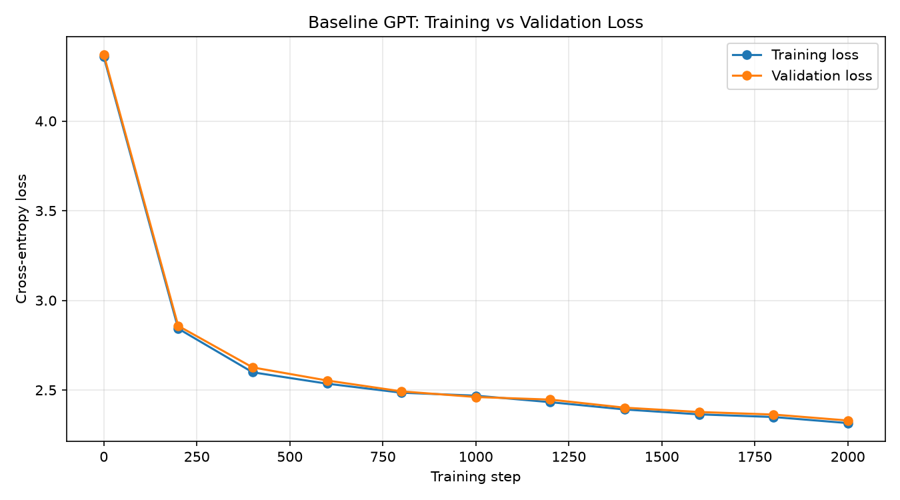
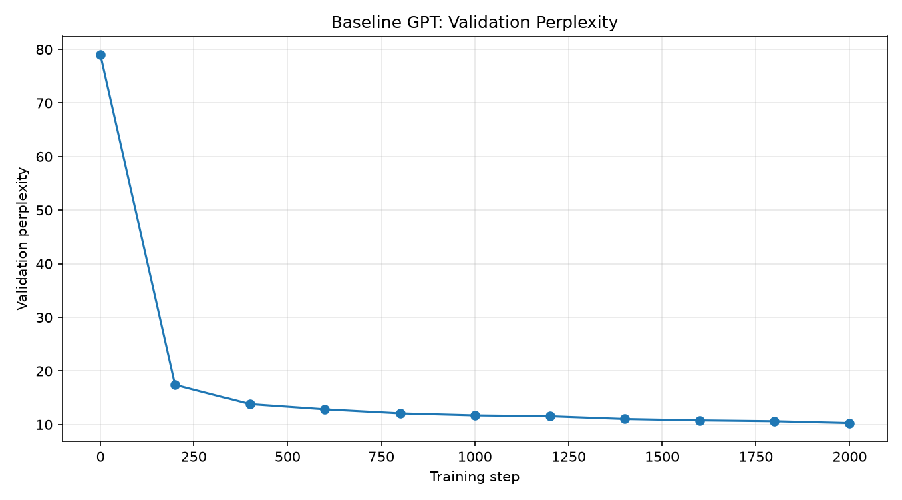
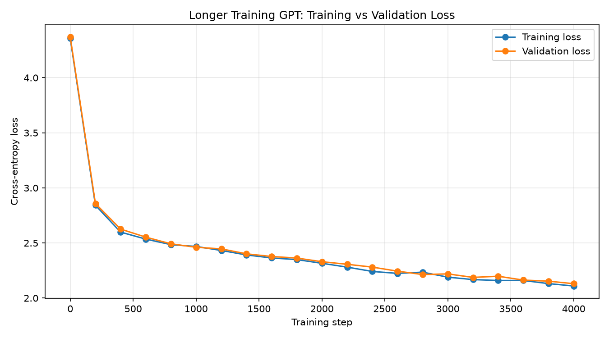
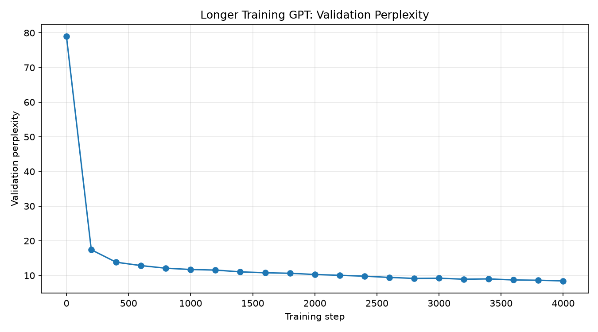
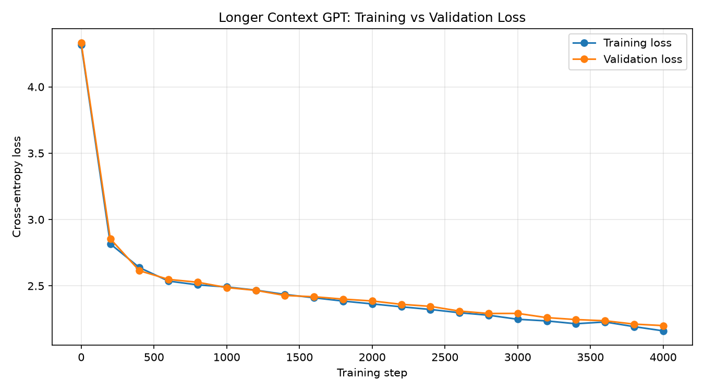
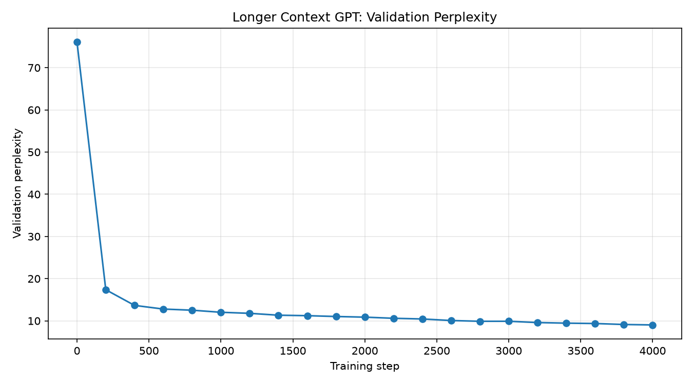
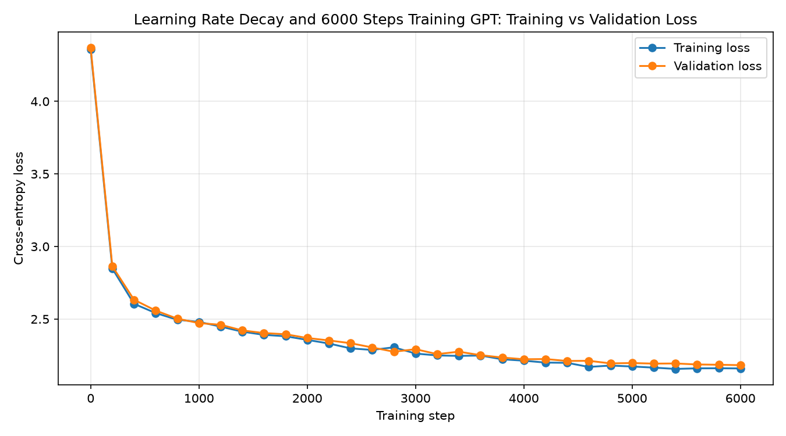
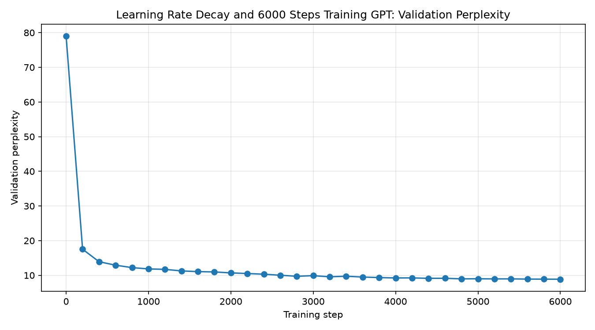

# Tiny GPT from Scratch

A small GPT-style language model implemented from scratch using PyTorch and trained on the Tiny Shakespeare dataset. This project explores Transformer architecture, next-character prediction, training behavior, and how different training configurations affect language-model performance.

The project was designed to run on a CPU without requiring a dedicated GPU.

## Table of Contents

- [Project Overview](#project-overview)
- [Dataset](#dataset)
- [Model Architecture](#model-architecture)
- [Training Configuration](#training-configuration)
- [Experiments and Results](#experiments-and-results)
- [Training Graphs](#training-graphs)
- [Generated Text Comparison](#generated-text-comparison)
- [Best Model Selection](#best-model-selection)
- [Project Structure](#project-structure)
- [Installation and Usage](#installation-and-usage)
- [Understanding the Metrics](#understanding-the-metrics)
- [Limitations and Future Improvements](#limitations-and-future-improvements)

## Project Overview

The objective of this project is to understand how GPT-style language models work by implementing and training a compact decoder-only Transformer.

Rather than using a pretrained language model, the model is initialized with random weights and learns character-level language patterns directly from the training dataset.

The project includes:

- Character-level tokenization.
- Token and positional embeddings.
- Causal self-attention and multi-head attention.
- Transformer blocks with feed-forward networks and residual connections.
- Training and validation loss tracking.
- Perplexity calculation.
- Experiments with training duration, context length, and learning-rate scheduling.
- Text generation using trained checkpoints.
- Graphs and recorded metrics for experiment comparison.

## Dataset

**Dataset:** Tiny Shakespeare

**Source:** [Tiny Shakespeare — Andrej Karpathy](https://raw.githubusercontent.com/karpathy/char-rnn/master/data/tinyshakespeare/input.txt)

The dataset contains Shakespeare's plays and is used here as a small corpus for character-level language modeling.

| Dataset property | Value |
|---|---:|
| Total characters | 1,115,394 |
| Vocabulary size | 65 |
| Training tokens | 1,003,854 |
| Validation tokens | 111,540 |

Each unique character is represented by a token ID. The model learns to predict the next character from the preceding characters.

The training split is used to optimize model parameters, while the validation split provides an independent measure of predictive performance during experimentation.

## Model Architecture

The model is a compact, decoder-only Transformer inspired by the GPT architecture.

### Architecture components

1. **Token embeddings:** Convert character token IDs into dense vectors.
2. **Positional embeddings:** Provide information about the position of each character in the input sequence.
3. **Causal self-attention:** Allows each position to attend to preceding positions without accessing future characters.
4. **Multi-head attention:** Uses multiple attention heads to learn different relationships in the input.
5. **Feed-forward network:** Applies nonlinear transformations to contextual representations.
6. **Residual connections:** Help information and gradients flow through the network.
7. **Layer normalization:** Normalizes hidden representations.
8. **Language-modeling head:** Produces logits for the next-character prediction.

During training, the model predicts the next character at each sequence position. Cross-entropy loss measures prediction error, and backpropagation with the AdamW optimizer updates the model parameters.

During generation, the model repeatedly predicts a probability distribution for the next character and samples a character from that distribution.

### Model configuration

| Hyperparameter | Standard configuration | Longer-context configuration |
|---|---:|---:|
| Embedding dimension | 64 | 64 |
| Attention heads | 4 | 4 |
| Transformer blocks | 2 | 2 |
| Context length | 64 | 96 |
| Batch size | 16 | 16 |
| Dropout | 0.1 | 0.1 |
| Initial learning rate | 0.0003 | 0.0003 |
| Trainable parameters | 112,193 | 114,241 |

The learning-rate-decay experiment uses a linear schedule that decreases the learning rate from `0.0003` to `0.00003` over 6,000 training steps.

## Training Configuration

Four experiments were completed to investigate how different training configurations affect validation performance.

### Experiment 1 — Baseline

The baseline establishes a reference point for subsequent experiments.

- Training steps: 2,000
- Context length: 64
- Parameters: 112,193
- Learning rate: 0.0003
- Batch size: 16

### Experiment 2 — Longer Training

This experiment increases training duration from 2,000 to 4,000 steps while keeping the standard architecture and context length unchanged.

The purpose is to investigate whether additional optimization improves next-character prediction.

- Training steps: 4,000
- Context length: 64
- Parameters: 112,193
- Learning rate: 0.0003
- Batch size: 16

### Experiment 3 — Longer Context

This experiment increases the context length from 64 to 96 characters while keeping the training duration at 4,000 steps.

The purpose is to test whether allowing the model to consider a longer preceding sequence improves predictive performance.

- Training steps: 4,000
- Context length: 96
- Parameters: 114,241
- Learning rate: 0.0003
- Batch size: 16

### Experiment 4 — Learning-Rate Decay

This experiment trains the standard architecture for 6,000 steps and gradually reduces the learning rate during training.

The purpose is to investigate whether smaller parameter updates later in training improve validation performance.

- Training steps: 6,000
- Context length: 64
- Parameters: 112,193
- Initial learning rate: 0.0003
- Final learning rate: 0.00003
- Schedule: Linear decay
- Batch size: 16

## Experiments and Results

The following results were recorded from the completed training runs.

| Experiment | Steps | Context | Parameters | Train loss | Validation loss | Validation perplexity |
|---|---:|---:|---:|---:|---:|---:|
| Baseline | 2,000 | 64 | 112,193 | 2.3158 | 2.3302 | 10.28 |
| Longer Training | 4,000 | 64 | 112,193 | 2.1098 | **2.1308** | **8.42** |
| Longer Context | 4,000 | 96 | 114,241 | 2.1610 | 2.2006 | 9.03 |
| Learning-Rate Decay | 6,000 | 64 | 112,193 | 2.1600 | 2.1824 | 8.87 |

### Results analysis

**Longer Training achieved the best validation performance** among the four completed experiments.

Compared with the baseline, the longer-training model reduced validation loss from 2.3302 to 2.1308 and perplexity from 10.28 to 8.42.

The longer-context model also improved over the baseline, but its validation loss was higher than that of the longer-training model. Increasing context length alone did not produce the best result in these experiments.

The 6,000-step learning-rate-decay experiment achieved better validation performance than the baseline and longer-context experiment. However, it did not outperform the 4,000-step longer-training model.

These findings apply to the configurations tested in this project. They do not establish that 4,000 steps or a context length of 64 is universally optimal.

## Training Graphs

The following graphs were generated from the recorded training histories.

### 1. Baseline — 2,000 Steps

**Training and validation loss**



**Perplexity**



### 2. Longer Training — 4,000 Steps

**Training and validation loss**



**Perplexity**



### 3. Longer Context — 4,000 Steps

**Training and validation loss**



**Perplexity**



### 4. Learning-Rate Decay — 6,000 Steps

**Training and validation loss**



**Perplexity**



These visualizations help illustrate how training and validation performance change over the course of optimization.

## Generated Text Comparison

Each trained model has its own generated text sample.

The generation script uses the same settings for each model:

| Setting | Value |
|---|---|
| Prompt | `ROMEO:` |
| Newly generated characters | 500 |
| Temperature | 0.7 |
| Random seed | 42 |

The longer-context checkpoint uses a context length of 96; the other three use a context length of 64.

### Baseline

[Read the baseline generated sample](generated_output/generated_baseline.txt)

### Longer Training

[Read the longer-training generated sample](generated_output/generated_longer_training.txt)

### Longer Context

[Read the longer-context generated sample](generated_output/generated_longer_context.txt)

### Learning-Rate Decay

[Read the 6,000-step learning-rate-decay generated sample](generated_output/generated_learning_rate_decay_6000.txt)

### How to compare the samples

When reviewing the generated text, consider:

- Whether the output resembles Shakespearean dialogue.
- Whether character names and dialogue formatting are plausible.
- Whether sentences and punctuation are reasonably structured.
- Whether the output contains repeated phrases or characters.
- Whether the text remains coherent across the generated passage.

The samples provide a qualitative comparison. Lower validation loss does not necessarily mean that every generated passage will be more readable, and a single sample is not enough to establish a model's overall generation quality.

## Best Model Selection

### Selected checkpoint: `longer_training_model.pth`

Based on the recorded validation metrics, the longer-training model is the best-performing model among the four experiments.

| Metric | Result |
|---|---:|
| Training steps | 4,000 |
| Context length | 64 |
| Trainable parameters | 112,193 |
| Final training loss | 2.1098 |
| Final validation loss | **2.1308** |
| Validation perplexity | **8.42** |

The checkpoint is located at:

`results/models/longer_training_model.pth`

### Why this model was selected

- It achieved the lowest validation loss of the four experiments.
- It achieved the lowest validation perplexity.
- It retains the smaller standard context configuration.
- It performed better on validation metrics than the 6,000-step learning-rate-decay experiment.

This selection is based on validation performance, not on the assumption that the model trained for the most steps must be the best.

## Project Structure

The project is organized to keep source code, trained checkpoints, graphs, experiment histories, and generated samples separate.

```text
Tiny-GPT/
├── data/
│   ├── input.txt
│   └── vocab.json
├── results/
│   ├── models/
│   │   ├── baseline_model.pth
│   │   ├── longer_training_model.pth
│   │   ├── longer_context_model.pth
│   │   └── learning_rate_decay_6000_model.pth
│   ├── graphs/
│   │   ├── baseline_loss.png
│   │   ├── baseline_perplexity.png
│   │   ├── longer_training_loss.png
│   │   ├── longer_training_perplexity.png
│   │   ├── longer_context_loss.png
│   │   ├── longer_context_perplexity.png
│   │   ├── learning_rate_decay_6000_loss.png
│   │   └── learning_rate_decay_6000_perplexity.png
│   └── history/
│       ├── baseline_history.json
│       ├── longer_training_history.json
│       ├── longer_context_history.json
│       └── learning_rate_decay_6000_history.json
├── generated_output/
│   ├── generated_baseline.txt
│   ├── generated_longer_training.txt
│   ├── generated_longer_context.txt
│   └── generated_learning_rate_decay_6000.txt
├── download_data.py
├── prepare_data.py
├── train_model.py
├── generate_text.py
├── structure.py
└── README.md
```

This illustrates the intended layout. If your actual repository has additional files, different names, or extra directories, preserve those rather than deleting them to match the illustration.

## Installation and Usage

### Prerequisites

- Python
- PyTorch
- Matplotlib for training graphs

Use a virtual environment to keep project dependencies isolated.

Install the required packages if they are not already installed:

```bash
python -m pip install torch matplotlib
```

### 1. Download the dataset

```bash
python download_data.py
```

### 2. Prepare the dataset

```bash
python prepare_data.py
```

### 3. Train the model

```bash
python train_model.py
```

Check the configuration and output filenames in `train_model.py` before starting another experiment so that existing results are not accidentally overwritten.

### 4. Generate text

```bash
python generate_text.py
```

Check the selected checkpoint path, vocabulary, architecture, and context length in `generate_text.py` before running it. The generation configuration must match the selected checkpoint.

Generated samples are saved in the `generated_output/` directory.

### 5. Organize experiment results

```bash
python structure.py
```

This script creates the result subdirectories and moves recognized checkpoint, graph, and history files from the root of `results/` into their respective directories. It skips files when the destination already contains a file with the same name.

## Understanding the Metrics

### Training loss

Measures next-character prediction error on training batches. A decreasing training loss generally indicates that the model is fitting the training data better.

### Validation loss

Measures next-character prediction error on held-out validation text. When the dataset and evaluation procedure are the same, a lower validation loss generally indicates better predictive performance on unseen examples from that dataset.

### Perplexity

Perplexity is the exponential of the average natural-log cross-entropy loss:

`Perplexity = exp(validation loss)`

Lower perplexity means the model assigns better average probability to the observed next characters. It does not guarantee factual correctness or human-quality writing.

### Parameter count

The number of trainable parameters in the model. Increasing parameter count can increase capacity and computational cost, but a larger model is not automatically better.

## Limitations and Future Improvements

### Current limitations

- The model is a small educational character-level Transformer, not a modern production-scale LLM.
- It learns only from the Tiny Shakespeare corpus.
- Generated passages can contain incoherent dialogue, repetition, and malformed words or sentences.
- Experiments were run with a limited set of configurations.
- Results may depend on random initialization, training batches, dataset splitting, and sampling settings.
- One generated sample per model is not sufficient for a comprehensive qualitative evaluation.

### Potential improvements

- Create a combined validation-loss graph comparing all four experiments.
- Automatically save the checkpoint with the lowest validation loss.
- Repeat experiments with multiple random seeds.
- Test additional learning-rate schedules.
- Evaluate more systematically for repetition and text quality.
- Experiment with different embedding dimensions, model depths, and context lengths.
- Add automated tests for checkpoint loading and generation.

## Acknowledgements

- [Tiny Shakespeare dataset](https://raw.githubusercontent.com/karpathy/char-rnn/master/data/tinyshakespeare/input.txt)
- [Andrej Karpathy — Let's build GPT: from scratch, in code, spelled out](https://www.youtube.com/watch?v=kCc8FmEb1nY)

This project is intended as a learning exercise to develop a practical understanding of Transformer language models, model training, evaluation, and text generation.